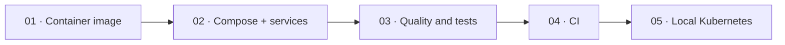

# Docker Python Guide

**An incremental, hands-on guide to containerizing, developing, testing and deploying Python applications.**


[](https://github.com/AndreaCarrilloOp/docker-python-guide/actions/workflows/ci.yml)

## Learning path

Clone once and follow the modules in order. Choose either the Flask/PostgreSQL track or the FastAPI/Redis track, or complete both. Each checkpoint can be run independently.

| Module | Skills | Flask track | FastAPI track |
|---|---|---|---|
| [01 · Containerization](modules/01-containerization/README.md) | Build and run standalone Python containers. | [flask-basic](modules/01-containerization/flask-basic/README.md) | [fastapi-basic](modules/01-containerization/fastapi-basic/README.md) |
| [02 · Local Development](modules/02-development/README.md) | Connect applications to PostgreSQL or Redis using Docker Compose. | [flask-postgres](modules/02-development/flask-postgres/README.md) | [fastapi-redis](modules/02-development/fastapi-redis/README.md) |
| [03 · Code Quality](modules/03-code-quality/README.md) | Add linting, type checking and functional tests. | [flask-quality](modules/03-code-quality/flask-quality/README.md) | [fastapi-quality](modules/03-code-quality/fastapi-quality/README.md) |
| [04 · Continuous Integration](modules/04-cicd/README.md) | Automate tests and container builds using GitHub Actions. | [flask-app](modules/04-cicd/flask-app/README.md) | [fastapi-app](modules/04-cicd/fastapi-app/README.md) |
| [05 · Kubernetes Deployment](modules/05-deployment/README.md) | Deploy the existing application and its backing service to a local Kubernetes cluster. | [flask-deployment](modules/05-deployment/flask-deployment/README.md) | [fastapi-deployment](modules/05-deployment/fastapi-deployment/README.md) |

## Requirements

- Git, Python 3.11, Docker Engine or Docker Desktop, and Docker Compose v2.
- For module 05: Docker Desktop Kubernetes or an equivalent local cluster, `kubectl`, and local images available to the cluster.
- Bash or PowerShell for commands.

## Quick start

```bash
git clone https://github.com/AndreaCarrilloOp/docker-python-guide.git
cd docker-python-guide
cd modules/01-containerization/flask-basic
docker build -t guide-flask:01 .
docker run --rm -p 127.0.0.1:5000:5000 guide-flask:01
```

Open http://localhost:5000/health. Stop the container before starting another example on the same port.

## Repository structure

```text
docker-python-guide/
├── modules/
│   ├── 01-containerization/
│   ├── 02-development/
│   ├── 03-code-quality/
│   ├── 04-cicd/
│   └── 05-deployment/
├── .github/workflows/ci.yml
├── .pre-commit-config.yaml
├── docs/
├── CONTRIBUTING.md
└── LICENSE
```

## Architecture



Flask evolves from a simple HTTP endpoint to a PostgreSQL-backed task API. FastAPI evolves from a simple endpoint to a Redis-backed user API. Later checkpoints retain these APIs, add quality tooling and automate verification.

## Testing and security

Each example has functional tests. The CI workflow builds images, starts dependencies when needed and checks HTTP health endpoints. Kubernetes manifest validation is separate from running a real cluster. Dependency ranges are used rather than claiming a reproducible lockfile.

Keep local database passwords in an ignored `.env` file or inject them through the environment. Do not commit credentials. Module 05 reads passwords from Kubernetes Secrets created outside Git. This is an educational local-deployment guide, not a hardened production platform.

See [migration history](docs/migration-history.md), [security notes](docs/security.md), and [contributing](CONTRIBUTING.md).

## License

[MIT](LICENSE)
