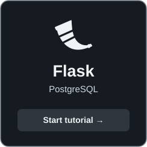
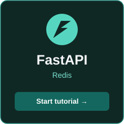

# Docker Python Guide

Learn to containerize, develop, test and deploy Python applications with Docker — one framework, five progressive modules.

## Choose your path

  
  &nbsp;
  

---

[Lab setup](docs/lab-setup.md) · [Dockerfile reference](docs/dockerfile.md) · [Security](docs/security.md) · [History](docs/migration-history.md) · [Contributing](CONTRIBUTING.md) · [MIT](LICENSE)
