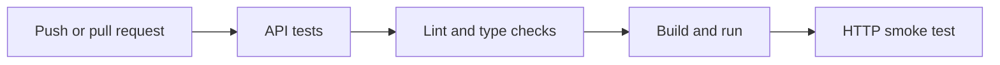

# Module 04 — Continuous Integration

[Previous module](../03-code-quality/README.md) · [Next module](../05-deployment/README.md)

## Overview

Automate tests and container builds using GitHub Actions.

Complete the preceding checkpoint first.

## Learning objectives

- Automate tests and container builds using GitHub Actions.
- Understand the relationship between Python application code and its runtime configuration.
- Verify a working example before continuing.

## Examples

| Track | Example |
|---|---|
| Flask | [flask-app](flask-app/README.md) |
| FastAPI | [fastapi-app](fastapi-app/README.md) |

## Implementation

The [repository workflow](../../.github/workflows/ci.yml) runs all example directories in an isolated matrix. Each job installs dependencies, checks Python code, runs API tests, builds a container or Compose stack, probes /health and cleans up. A successful build is a CI checkpoint, not an automatic production deployment.

## Validation

Follow the selected example README. Confirm that its functional tests pass and that the HTTP health endpoint responds successfully before moving on.

## Next checkpoint

[Next module](../05-deployment/README.md)
